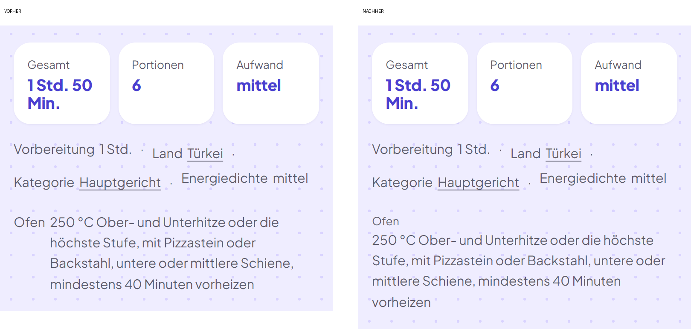
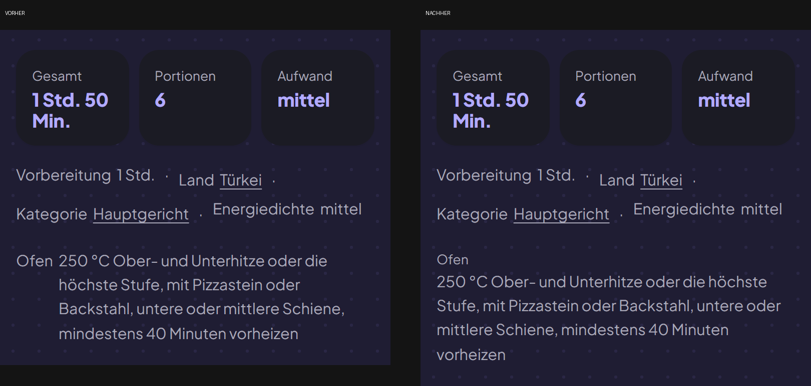

# AP-44: Website – Links zum Play Store mit Kennung des Kanals, Ofenzeile ohne Einzug, Dependabot-Warnungen

Auftrag der Projektleitung vom 25.10.2026, Alis Ja vom 24. und 25.10.2026. Gearbeitet nur in `foodasu-web` (Zweig
`ap-44` von `main` `f8768b6`) und `foodasu-play` (Teil D). `einkauf-app` nicht angefasst. Rechtstexte unverändert.

**Stand 25.10.2026: NICHT veröffentlicht, angehalten nach Teil C Nr. 4.** `main` steht weiter auf `f8768b6`, nichts
gepusht. Grund: Nach dem Update der Pakete unterscheiden sich zwei fertige JavaScript-Dateien der Seiten (Abschnitt 5).
Der Auftrag verlangt dann Anhalten und Melden. Teil A und B sind fertig und geprüft (Commit `753eda1`), Teil C ist
eingespielt und geprüft (Commit `8e0b704`), Teil D liegt bereit.

## 1. Ergebnis in Kürze

- **Teil A:** 180 Links zu Google Play tragen die Kennung, 4 bleiben bewusst ohne (Fußzeile der vier Seiten mit
  Rechtstexten). Alle fünf Kennungen rufen den richtigen Eintrag ab (Abschnitt 2).
- **Teil B:** Ofenzeile mit „Ofen“ als kleiner Beschriftung in eigener Zeile, Angaben darunter bündig links
  (Einzug vorher 42,5 px, nachher 0). Hell, dunkel, Handy und 200 Prozent Zoom (Abschnitt 3).
- **Teil C:** 3 offene Warnungen bei Dependabot (alle `vite`), `npm audit` zeigte dazu `undici` und `zod`. Nach
  `npm audit fix` ohne `--force`: 0 Funde. Keine Sprünge der Hauptversion. Keine offenen Pull Requests von Dependabot.
- **Angehalten:** Das Update ändert zwei JS-Dateien der fertigen Seiten (Hilfscode von Vite). Alles andere am Bau ist
  gleich (Abschnitt 5).
- **Teil D:** `foodasu-play\Social_Media_2026-10\Store_Links_mit_Kennung.md`.

## 2. Teil A: geänderte Links

Format wie beim „Google Play URL Builder“:
`https://play.google.com/store/apps/details?id=at.tonc.einkauf&referrer=utm_source%3Dwebsite%26utm_medium%3Dlink%26utm_campaign%3D<ort>`
(im HTML mit `&amp;`). Quelle: `storeLink(ort)` in `src/daten/seite.mjs`; ein unbekannter Ort bricht den Bau ab.

| `<ort>` | Stelle | Links im Bau |
|---|---|---|
| `kopf` | Startseite, Knopf im Kopf („Jetzt im Play Store“) | 1 |
| `abschluss` | Startseite, Knopf im Abschluss | 1 |
| `kurzleiste` | Startseite, Leiste unten am Handy | 1 |
| `rezept` | Knopf „Jetzt im Play Store“ auf den Rezeptseiten | 65 |
| `fuss` | Google-Play-Abzeichen in der Fußzeile jeder anderen Seite | 112 |

Die Werte sind nach Stelle gewählt, nicht nach Seite: Das Abzeichen steht in der Fußzeile jeder Seite und wäre sonst
ein Wert je Seitenart. Wenn Ali die Fußzeile nach Seitenart trennen will (zum Beispiel `fuss-so-gehts`), ist das eine
kleine Änderung.

**Ohne Kennung (wie im Auftrag):** strukturierte Daten (`MobileApplication` mit `installUrl`, `sameAs`), `llms.txt`,
Sitemap. **Dazu bewusst:** das Abzeichen in der Fußzeile von `/datenschutz.html`, `/nutzungsbedingungen.html`,
`/offenlegung/` und `/lizenzen/` (4 Links). Auslegung: „Rechtstexte nicht ändern“ heißt, diese vier fertigen Seiten
bleiben Byte für Byte gleich; im Vergleich der Baue sind sie unverändert. Wenn Ali dort auch die Kennung will: eine
Zeile in `Fuss.astro` und `pruefe_seiten.mjs`.

Die Kennung enthält nichts über Besucher; die Website lädt dafür nichts nach und speichert nichts.

### Prüfungen zu Teil A

- **Abruf:** alle fünf Adressen mit Kennung geben 200 und führen zum Eintrag „FoodAsu: Einkaufsliste+Scanner“
  (Canonical `…details?id=at.tonc.einkauf&hl=de_AT`, `og:title` wie der Eintrag). `tools/links_pruefen.mjs`: 82 Adressen
  auf 27 Rechnern, 78 mit Status 200, 4 „prüfen“ (vier Facebook-Adressen mit 400; das ist Facebooks Antwort auf Skripte,
  steht schon vor AP-44 so da und hat mit der Änderung nichts zu tun).
- **Neue Prüfung im Bau** (`npm run pruefen`, `tools/pruefe_seiten.mjs`): jeder Link zu `play.google.com/store/apps/details`
  im HTML (ohne JSON-LD) muss eine der fünf Kennungen tragen; ohne Kennung nur das Abzeichen auf den vier Seiten mit
  Rechtstexten. Meldet auch eine Kennung in `llms.txt` oder Sitemap und Schreibweisen, die die Suche umgehen würden.
  Ausgabe: „Links zu Google Play: 184 im HTML, davon 4 ohne Kennung auf Seiten mit Rechtstexten (erlaubt)“.
  **Gegenprobe:** in einer Kopie des Baus eine Kennung entfernt (Rezeptseite) und eine geändert (Fragen): drei Befunde,
  Ergebnis „3 Befunde“. Im echten Bau: „Ergebnis: bestanden“.
- Zwei bestehende Prüfungen angepasst: „derselbe Linktext führt nicht zu verschiedenen Zielen“ vergleicht das Ziel jetzt
  ohne Kennung (Kopf und Abschluss tragen denselben Text mit zwei Kennungen); die Prüfung der Startseite verlangt
  `kopf` im Kopf und `abschluss` im Abschluss. `tools/sogehts_links.mjs` kennt den Fuß-Link mit Kennung.
- Prüfumfang nach CLAUDE.md: Bau, `npm run pruefen`, Links. Wortprüfung und Nachweise der Seiten nicht gelaufen, weil
  kein Text geändert ist (nur Links und eine CSS-Regel).

## 3. Teil B: Ofenzeile

`.r-ofen div { display: block; }` und `.r-ofen dt { font-size: 0.82rem; }` in `src/styles/rezepte.css` (gleiche Größe wie
die Beschriftungen „Gesamt“, „Portionen“). Sonst nichts an der Gestaltung. Gemessen mit Chrome (Puppeteer) auf
`lahmacun` (längster Text, 4 Zeilen am Handy) und `apfelstrudel` (kurz):

| Ansicht | Einzug des Textes vorher | nachher | Zeilen des Textes | waagrechter Überlauf |
|---|---|---|---|---|
| Handy 390 px, hell und dunkel | 42,5 px | 0 | 4 / 2 | nein |
| 200 Prozent Zoom (640 px breit, Faktor 2), hell und dunkel | 42,5 px | 0 | 2 / 1 | nein |

Vorher-nachher (links vorher, rechts nachher), in `docs/berichte/AP-44_Bilder/`:

- `ofen_lahmacun_handy_hell.png`, `ofen_lahmacun_handy_dunkel.png`
- `ofen_lahmacun_zoom200_hell.png`, `ofen_lahmacun_zoom200_dunkel.png`
- `ofen_apfelstrudel_handy_hell.png`, `ofen_apfelstrudel_zoom200_dunkel.png`

Die Zeile steht auf 11 Rezeptseiten (apfelstrudel, baklava, butter-chicken, croissants, lahmacun,
lasagne-alla-bolognese, moussaka, pizza-margherita, quiche-lorraine, sachertorte, schwarzwaelder-kirschtorte).

## 4. Teil C: Warnungen

### Vorher (GitHub, `gh api …/dependabot/alerts`, offen)

| # | Schwere | Paket | betroffen | behoben in | Kurzbeschreibung | wo wirkt es |
|---|---|---|---|---|---|---|
| 3 | hoch | vite | 8.3.0 bis 8.3.2 | 8.3.3 | launch-editor: Prüfung `fs.existsSync()` auf Windows umgehbar | nur Entwicklungs-Server |
| 2 | mittel | vite | 8.3.0 bis 8.3.2 | 8.3.3 | launch-editor: Editor-Schalter falsch gedeutet, Befehl ausführbar | nur Entwicklungs-Server |
| 1 | mittel | vite | 8.3.0 bis 8.3.2 | 8.3.3 | launch-editor: `%` bei Windows nicht maskiert | nur Entwicklungs-Server |

Dependabot nennt den Bereich „runtime“; Vite ist hier aber das Bauwerkzeug von Astro (indirekt, über `astro`). Die
drei Lücken liegen im Entwicklungs-Server (`astro dev`, launch-editor); den gibt es auf foodasu.com nicht. Im Browser der
Besucher läuft nur der kleine Hilfscode von Vite für das Nachladen von Skripten (siehe Abschnitt 5), nicht die Lücken.

`npm audit` meldete zusätzlich (nicht bei Dependabot gelistet): `undici` 8.11.2 (hoch, nur Bau: Abruf der Schriften durch
`unifont`), `zod` 4.6.5 (hoch, nur Bau und Prüfwerkzeug) und drei weitere Vite-Hinweise (Entwicklungs-Server). In
`dist/` kommt keines dieser Pakete vor (gesucht nach `undici`, `ZodError`, `launch-editor`: kein Treffer).

### Update

`npm audit fix` (ohne `--force`), nur `package-lock.json`, `package.json` unverändert. Erlaubte Bereiche eingehalten, kein
Sprung der Hauptversion nötig:

- vite 8.3.2 → 8.3.5 (mit rolldown 1.2.12 → 1.2.15, @oxc-project/types 0.152 → 0.155, postcss 8.5.29 → 8.5.31)
- undici 8.11.2 → 8.12.3
- zod 4.6.5 → 4.6.7

### Nachher

`npm audit`: 0 Funde. Bei Dependabot schließen sich die drei Warnungen erst, wenn der Stand auf `main` steht
(noch nicht passiert). Offene Pull Requests von Dependabot: keine (`gh pr list --state open`: leer). Nichts
zusammengeführt.

## 5. Vergleich der Baue und Grund für das Anhalten

Drei Baue: **Ausgang** (`main` `f8768b6`), **A+B** (Commit `753eda1`), **Update** (Commit `8e0b704`). Jeweils 967 Dateien.

- **Ausgang → A+B:** 113 Textdateien anders (112 Seiten plus `sitemap.xml`). Nach Abzug der Kennungen, des neuen
  Hash-Namens der Stildatei und der Sitemap-Daten bleibt **kein** Unterschied. Die Stildatei hat nur die zwei neuen Regeln
  dazu. Die vier Seiten mit Rechtstexten sind unverändert. In `sitemap.xml` ändert sich `lastmod` (kommt aus dem Git-Datum
  der Quelldateien; `Fuss.astro` und `seite.mjs` sind heute geändert), sonst nichts.
- **A+B → Update:** Alle HTML-Seiten, CSS, Bilder und Daten gleich. **Anders sind zwei JavaScript-Dateien**, in
  `index.html` ändert sich dadurch nur der Dateiname im Verweis:
  - `_astro/bewegung.*.js`: 115.875 → 115.828 Byte (gsap und Bewegung der Startseite),
  - `_astro/index.astro_astro_type_script_index_0_lang.*.js`: 3.894 → 4.030 Byte.

  Ursache: Vite 8.3.5 enthält einen geänderten Hilfscode für das Nachladen von Skripten (`__vitePreload`, jetzt mit
  Zwischenspeicher für laufende Ladevorgänge). Der Code von FoodAsu und von gsap ist gleich. Das ist keine sichtbare
  Änderung, aber Code im Browser der Besucher, deshalb angehalten.
- Gegenprobe im Browser (Chrome, Startseite, Bau vor und nach dem Update): keine Konsolenfehler, beide Dateien laden
  mit 200, „Bewegung anhalten“ erscheint und wechselt zu „Bewegung fortsetzen“, Klasse `angehalten` gesetzt: in beiden
  Bauen gleich. `npm run pruefen` nach dem Update: bestanden.

**Empfehlung:** In zwei Schritten veröffentlichen. Erst `753eda1` (Teil A und B; der Bau ist bis auf Links und
Ofenzeile gleich dem heutigen), dann `8e0b704` (Update) mit Alis Ja zur Änderung der zwei Skripte. Die Lücken des
Updates betreffen nur den Entwicklungs-Server, die Eile ist also gering. Alternativ beides zusammen mit einem Ja.
Zum Vorspulen: `main` auf `753eda1` (oder `8e0b704`), danach live prüfen: drei Seiten mit Links, zwei Rezeptseiten mit
Ofenzeile, Stand der Warnungen bei Dependabot.

## 6. Offen

- Alis Ja zum Veröffentlichen (Abschnitt 5, Empfehlung) und zur Auslegung „Rechtstexte ohne Kennung im Fuß“.
- Nach dem Veröffentlichen: Live-Prüfung (967 von 967 Dateien gleich dem Bau, drei Seiten mit Kennung, zwei Rezeptseiten
  mit Ofenzeile, Dependabot).
- Play Console: Die Kennungen werden dort erst nach Besuchen sichtbar (Teil D nennt die Stelle).

## Für einkauf-app\CLAUDE.md

AP-44 (Website, 25.10.2026, `foodasu-web` Zweig `ap-44`, NICHT veröffentlicht): Links zu Google Play mit Kennung
(`utm_source=website`, `utm_medium=link`, `utm_campaign=kopf|abschluss|kurzleiste|rezept|fuss`, Quelle `storeLink()` in
`src/daten/seite.mjs`; ohne Kennung: strukturierte Daten, `llms.txt`, Sitemap, Fuß der vier Seiten mit Rechtstexten;
Prüfung im Bau in `npm run pruefen`), Ofenzeile ohne Einzug (CSS `.r-ofen`), Pakete aktualisiert (vite 8.3.5, undici
8.12.3, zod 4.6.7, `npm audit` 0). Angehalten, weil das Update zwei JS-Dateien der Seiten ändert (Vite-Hilfscode); Commits
`753eda1` (A und B) und `8e0b704` (Update), Bericht `foodasu-web/docs/berichte/AP-44_Bericht.md`. Teil D:
`foodasu-play\Social_Media_2026-10\Store_Links_mit_Kennung.md`.
